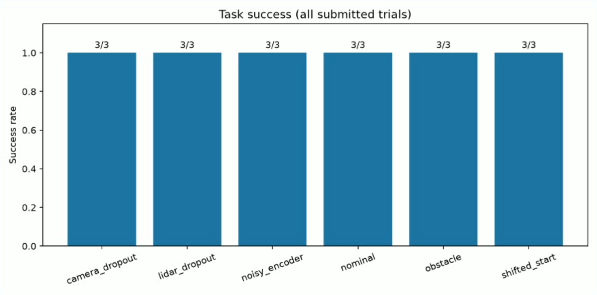
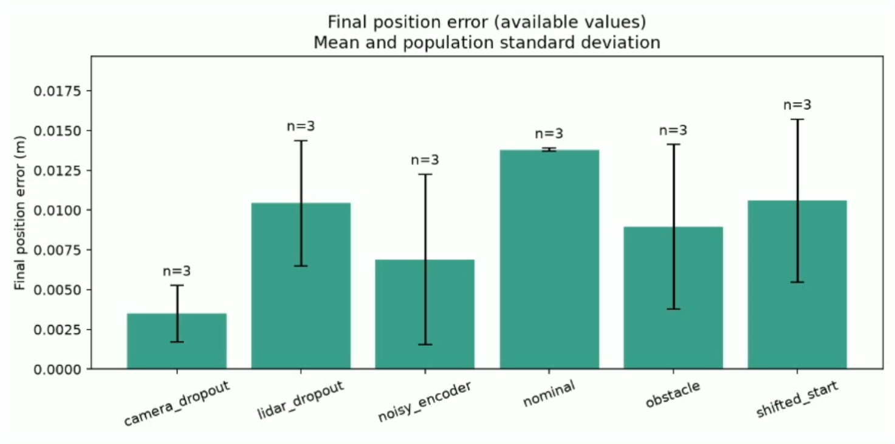

# Sensor and Control - Integrated Project

**Final demonstration:** [TurtleBot3 Visual Waypoint Navigation and Docking](https://youtu.be/V5EIhJ3kfyU)  
**Final simulation entry point:** `run_navigation.py`


## Project Overview

**Course:** 41014 Sensors and Control in Mechatronics Systems  
**Project:** Track A – TurtleBot3 Visual Waypoint Navigation  
**Platform:** TurtleBot3 Waffle Pi in MuJoCo

This project implements an autonomous mobile robot that navigates an environment containing obstacles and docks at an ArUco-marked charging station. The final system completed **18/18 tested navigation and docking trials with no collisions** across six simulation conditions.

The system integrates wheel encoder odometry, LiDAR sensing, camera-based ArUco detection, Extended Kalman Filter (EKF) localisation, and feedback control.

The controller uses estimated robot states rather than simulator ground truth. Ground truth is used only for performance evaluation.

## System Architecture

The system consists of five main components:

1. **Modelling:** Differential-drive robot kinematics and state-space modelling.
2. **Sensing:** Wheel encoders, 2D LiDAR and an RGB camera.
3. **Estimation:** EKF combining encoder odometry with ArUco-based pose measurements.
4. **Control:** LQR path tracking, encoder-feedback wheel servoing and PBVS visual docking, using estimated robot states.
5. **Integration:** LiDAR occupancy-grid planning, active obstacle avoidance, visual docking and robustness evaluation.

### Data Flow

```text
Wheel encoders ──────┐
                     ├──> EKF estimated [x, y, heading] ──┐
Camera / ArUco ──────┘                                     │
                                                           v
LiDAR ──> Occupancy grid ──> Path planning ──> LQR tracking
   │                                                   │
   └──> Motion safety check <── PBVS visual docking <───┘
                        │
                        v
                  Wheel-speed servo
                        │
                        v
                 TurtleBot3 (MuJoCo)
```

The full system transitions between `NAVIGATE`, `ACQUIRE_MARKER`, `VISUAL_DOCK`, and, when required, `ALIGN_APPROACH`, before reaching `DOCKED`.

## Technical Implementation


### A. Robot Modelling

The TurtleBot3 Waffle Pi is modelled as a differential-drive mobile robot operating on a planar surface.

**Robot parameters:**

| Parameter | Value |
|---|---|
| Wheel radius | 0.033 m |
| Wheel separation | 0.287 m |
| Robot state | [x, y, theta] |
| Control inputs | Linear velocity v, angular velocity omega |

#### Differential-Drive Kinematics

The nonlinear kinematic model is:

$$
\dot{x}=v\cos\theta
$$

$$
\dot{y}=v\sin\theta
$$

$$
\dot{\theta}=\omega
$$

Wheel angular velocities are calculated from the commanded body velocities:

$$
\omega_L=\frac{v-\omega L/2}{r}
$$

$$
\omega_R=\frac{v+\omega L/2}{r}
$$

where r is the wheel radius and L is the wheel separation.

#### Linearised State-Space Model

For LQR trajectory tracking, the nonlinear model is locally linearised around a moving reference trajectory.

The tracking error state is:

$$
\mathbf{e}=[e_x,e_y,e_\theta]^T
$$

The discrete error dynamics are:

$$
\mathbf{e}_{k+1}=A\mathbf{e}_k+B\Delta\mathbf{u}_k
$$

with:

$$
A=
\begin{bmatrix}
1&0&0\\
0&1&v_r\Delta t\\
0&0&1
\end{bmatrix}
$$

$$
B=
\begin{bmatrix}
\Delta t&0\\
0&0\\
0&\Delta t
\end{bmatrix}
$$

The reference speed is 0.12 m/s and the control interval is 0.02 s.

This local error model is used to design the LQR controller described in Section D.

#### Controllability Analysis

Controllability is evaluated using:

$$
\mathcal{C}=[B,\ AB,\ A^2B]
$$

At the moving reference speed of 0.12 m/s, the controllability matrix has rank 3.

This means all three local tracking-error states are controllable under the moving-reference linearisation.

At zero reference speed, the controllability rank decreases to 2. Therefore, the moving-reference LQR model alone is insufficient for all stationary alignment and docking manoeuvres.

Separate nonlinear feedback control is used for these operations.

#### Observability Analysis

With a valid camera-based global pose measurement, the local measurement model uses:

$$
C=I_3
$$

The observability matrix is:

$$
\mathcal{O}=
\begin{bmatrix}
C\\
CA\\
CA^2
\end{bmatrix}
$$

The resulting observability rank is 3 when the camera provides a valid pose measurement.

However, wheel encoders alone cannot correct accumulated absolute position and heading drift. When the ArUco marker is outside the camera's field of view, the EKF relies on odometry prediction until valid visual measurements return.

This analysis applies to the local linearised model and does not establish global controllability or observability of the complete nonlinear system.

**Implementation:** `src/navigation/analysis.py` and `src/navigation/control.py`.


### B. Sensing

The TurtleBot3 Waffle Pi uses wheel encoders, a simulated 2D LiDAR and a front-mounted RGB camera for navigation and localisation.

The sensors provide measurements to the EKF, occupancy-grid planner and navigation safety system.

#### Camera and ArUco Detection

The RGB camera captures images directly from the MuJoCo simulation. OpenCV is used to detect an ArUco marker and estimate its pose.

**Camera configuration:**

| Parameter | Value |
|---|---|
| Resolution | 640 × 480 |
| Vertical field of view | 60° |
| Camera position | (0.10, 0.00, 0.12) m |
| Measurement interval | 0.10 s |
| ArUco dictionary | DICT_4X4_50 |
| Marker ID | 0 |
| Marker size | 0.18 m |
| Pose estimation | solvePnP (ITERATIVE) |

The camera intrinsic matrix is calculated from the image dimensions and the camera's field of view.

ArUco corner detection uses subpixel refinement to improve measurement accuracy.

The system also checks measurement validity:

- Marker ID verification.
- Valid marker distance between 0.12 m and 5 m.
- Reprojection error threshold of 2 pixels.
- Pose validity and finite-value checks.

The marker pose is converted into the robot's world-frame position and heading using the known camera mounting transform and marker location.

Valid visual pose measurements are supplied to the EKF.

#### LiDAR Sensing

A simulated 2D LiDAR is implemented using MuJoCo ray casting.

**LiDAR configuration:**

| Parameter | Value |
|---|---|
| Number of beams | 180 |
| Maximum range | 5.0 m |
| Mounting position | (-0.049, 0.00, 0.20) m |
| Map resolution | 0.07 m |
| Obstacle inflation radius | 0.24 m |

The LiDAR measurements are used to update a 2D occupancy grid, detect obstacles and support autonomous path planning.

The implementation includes:

- Range validity checking.
- Robot self-geometry exclusion.
- Log-odds occupancy-grid updates.
- Obstacle inflation for clearance.
- Local motion safety checks.
- Detection of unavailable or invalid measurements.

The navigation safety layer also checks the proposed robot motion against nearby LiDAR measurements and stops potentially unsafe commands.

#### Wheel Encoder Measurements

Wheel joint measurements provide odometry information for the EKF prediction step.

The final simulation uses an encoder measurement noise standard deviation of 0.0003 rad under normal conditions.

The noisy-encoder test increases this value to 0.0015 rad to evaluate robustness.

These values represent simulated measurement noise assumptions rather than physical encoder calibration results.

#### Coordinate Frames

The system uses four main coordinate frames:

- **World frame (W):** Global reference for robot navigation and the charging station.
- **Robot base frame (B):** Attached to the TurtleBot3, with +X forward and +Y left.
- **Camera frame (C):** Used for visual measurements and ArUco pose estimation.
- **Marker frame (M):** Attached to the known ArUco landmark.

The LiDAR sensor also has a fixed mounting transform relative to the robot base.

**Visual measurement transformation:**

```text
Known Marker Pose (World Frame)
                |
                v
         Marker Frame (M)
                ^
                |
       ArUco Detection
                |
         Camera Frame (C)
                |
       Camera Extrinsics
                |
                v
       Robot Base Frame (B)
                |
                v
      Estimated World Pose
                |
                v
                EKF
```

The complete camera rotation and translation are considered when converting visual measurements into the robot's planar pose.

LiDAR measurements are transformed using the estimated robot pose to update the global occupancy grid.

Simulator ground truth is not used as a measurement for localisation or navigation control.

#### Noise Handling and Sensor Dropout

The system includes tests for measurement noise and temporary sensor loss.

- Invalid LiDAR readings are not treated as free space.
- Camera measurements are checked before being passed to the EKF.
- The EKF rejects inconsistent visual pose measurements using innovation gating.
- Camera and LiDAR dropout conditions are included in the final robustness evaluation.

The camera intrinsic parameters and mounting geometry are defined from the simulation model. The injected noise parameters are simulation assumptions, not experimentally measured physical sensor characteristics.

**Implementation:** `src/navigation/vision.py`, `src/navigation/planner.py`, `src/navigation/runner.py` and the existing LiDAR evaluation modules.


### C. State Estimation

The final system uses an Extended Kalman Filter (EKF) to estimate the TurtleBot3's position and heading.

The estimated state is:

$$
\hat{\mathbf{x}}=[\hat{x},\hat{y},\hat{\theta}]^T
$$

The EKF combines wheel encoder odometry with camera-based ArUco pose measurements.

#### EKF Prediction

Wheel encoder measurements provide the travelled distance and heading change:

$$
\Delta d=\frac{\Delta d_L+\Delta d_R}{2}
$$

$$
\Delta\theta=\frac{\Delta d_R-\Delta d_L}{L}
$$

The predicted robot pose is:

$$
\hat{x}_{k+1}=\hat{x}_k+\Delta d\cos(\hat{\theta}_k+\Delta\theta/2)
$$

$$
\hat{y}_{k+1}=\hat{y}_k+\Delta d\sin(\hat{\theta}_k+\Delta\theta/2)
$$

$$
\hat{\theta}_{k+1}=\hat{\theta}_k+\Delta\theta
$$

The covariance is propagated using:

$$
P_{k+1}^{-}=FP_kF^T+Q_k
$$

The process noise covariance is calculated from wheel-motion uncertainty and additional time-dependent model uncertainty, rather than using a single fixed matrix.

#### EKF Visual Update

The RGB camera detects ArUco markers using OpenCV.

The detected marker pose is transformed into the world frame using the known marker location and camera mounting geometry.

The EKF uses the visual pose measurement to correct the predicted robot position and heading.

The measurement innovation is:

$$
\mathbf{y}=\mathbf{z}-\hat{\mathbf{x}}^{-}
$$

The Kalman gain is:

$$
K=P^{-}(P^{-}+R)^{-1}
$$

The corrected state is:

$$
\hat{\mathbf{x}}^{+}=\hat{\mathbf{x}}^{-}+K\mathbf{y}
$$

Heading differences are angle-wrapped to avoid discontinuities around ±pi.

The implementation also uses innovation-based measurement gating to reject inconsistent camera measurements, followed by Joseph-form covariance updating for numerical stability.

#### EKF Parameters

| Parameter | Final Value |
|---|---|
| Estimated state | [x, y, theta] |
| Initial position standard deviation | 0.015 m |
| Initial heading standard deviation | 2° |
| Camera position measurement standard deviation | 0.025 m |
| Camera heading measurement standard deviation | 3° |
| Visual innovation gate | 16.27 |
| Control and prediction interval | 0.02 s |
| Camera measurement interval | 0.10 s |

The camera measurement covariance is:

$$
R=\operatorname{diag}(0.025^2,\ 0.025^2,\ (3\pi/180)^2)
$$

The process covariance Q is updated using the measured wheel displacement and elapsed simulation time.

These covariance parameters represent the simulation's assumed measurement and motion uncertainty and should not be interpreted as physical sensor calibration results.

#### Localisation and Uncertainty Evaluation

The EKF estimates the robot pose throughout navigation and visual docking.

- Ground truth is used only for independent evaluation.
- Estimated and true robot trajectories are recorded.
- Estimation errors and covariance bounds can be plotted.
- Temporary camera dropout is included in the robustness tests.
- Invalid or inconsistent visual measurements are rejected.

When camera measurements are unavailable, uncertainty can increase as the EKF relies on wheel odometry.

The final system completed all 18 submitted navigation and docking trials across six experimental conditions. These task-success results do not, by themselves, establish a particular EKF estimation RMSE; localisation accuracy is evaluated separately using recorded estimated and true states.

**Implementation:** `src/navigation/estimation.py` and `src/navigation/vision.py`.


### D. Control and Navigation

The final navigation system combines occupancy-grid path planning, discrete LQR trajectory tracking, wheel-speed feedback control, and position-based visual servoing (PBVS).

All navigation and control decisions use the EKF-estimated robot pose rather than MuJoCo ground truth.

#### State-Space Model and LQR Control

The LQR controller uses a local linearised error model defined in the moving reference frame:

$$
\mathbf{e}=[e_x,e_y,e_\theta]^T
$$

where the states represent along-track, cross-track and heading errors.

The discrete-time model is:

$$
\mathbf{e}_{k+1}=A\mathbf{e}_k+B\Delta\mathbf{u}_k
$$

with:

$$
A=
\begin{bmatrix}
1&0&0\\
0&1&v_r\Delta t\\
0&0&1
\end{bmatrix}
$$

$$
B=
\begin{bmatrix}
\Delta t&0\\
0&0\\
0&\Delta t
\end{bmatrix}
$$

The local LQR model is linearised about 0.12 m/s with a 0.02 s sampling interval. The implemented tracker uses a nominal 0.10 m/s forward-velocity command, adjusted through LQR feedback.

The discrete LQR feedback law is:

$$
\Delta\mathbf{u}=-K\mathbf{e}
$$

The weighting matrices are:

$$
Q=\operatorname{diag}(6,40,10)
$$

$$
R=\operatorname{diag}(4,2)
$$

The LQR gain is computed numerically by iteration of the discrete Riccati equation.

The implementation prioritises cross-track and heading accuracy while limiting excessive control effort.

**Controller parameters:**

| Parameter | Value |
|---|---|
| Control interval | 0.02 s |
| LQR reference speed | 0.12 m/s |
| Maximum forward velocity | 0.14 m/s |
| Maximum angular velocity | 0.75 rad/s |
| LQR state weights Q | diag(6, 40, 10) |
| LQR input weights R | diag(4, 2) |

For large heading errors, the robot first rotates towards the desired direction before continuing forward motion.

The model and controller are implemented in `src/navigation/control.py`.

#### Autonomous Obstacle Avoidance

The navigation system builds a 2D occupancy grid using LiDAR range measurements and the EKF-estimated robot pose.

The planner includes:

- Occupancy-grid mapping using log-odds updates.
- Obstacle inflation to account for robot clearance.
- A grid-based path search with diagonal movement.
- Path simplification using collision-checked shortcuts.
- Periodic replanning as sensor measurements update the map.

**Planner parameters:**

| Parameter | Value |
|---|---|
| Grid resolution | 0.07 m |
| Obstacle inflation radius | 0.24 m |
| Replanning interval | 0.5 s |

The environment's actual obstacle positions are not supplied to the planner. Navigation decisions are based on LiDAR observations and the estimated robot state.

An additional safety layer checks the proposed motion against nearby LiDAR measurements and stops unsafe commands.

The planner is implemented in `src/navigation/planner.py`.

#### Wheel-Speed Feedback

The controller converts linear and angular velocity commands into individual wheel-speed commands.

A wheel-speed feedback loop uses encoder measurements, proportional-integral correction and friction feedforward compensation.

This improves low-speed motion compared with the original baseline controller, which experienced difficulty approaching the target accurately.

#### Visual Servoing and Docking

After navigating near the charging station, the robot switches from path tracking to visual docking.

The docking controller uses ArUco-based pose measurements fused through the EKF to regulate the final robot position and heading.

The main navigation stages are:

1. **NAVIGATE:** Follow the planned route using LQR.
2. **ACQUIRE_MARKER:** Align the camera towards the ArUco marker.
3. **VISUAL_DOCK:** Approach the final charging pose using PBVS.
4. **ALIGN_APPROACH:** Reposition when a close-range alignment correction is needed.
5. **DOCKED:** Stop after the docking conditions are maintained.

The docking goal is:

$$
[x_g,y_g,\theta_g]=[1.05,\ 0,\ 0]
$$

The controller checks estimated position and heading errors, recent visual measurements and a stability holding period before declaring the docking operation complete.

The final evaluation independently verifies the result using simulator ground truth.

#### Baseline Comparison

During early development, a proportional waypoint controller was used to test differential-drive motion and EKF feedback.

The final system replaces this baseline with LQR trajectory tracking, autonomous path planning and visual docking.

The final system's quantitative performance is presented in Section E.


### E. Integration and Robustness

The final integrated system combines LiDAR-based obstacle avoidance, camera-based ArUco localisation, EKF state estimation, LQR trajectory tracking, and PBVS visual docking.

The complete navigation system is implemented in `run_navigation.py` and `src/navigation/`.

The robot uses LiDAR measurements to update an occupancy grid and plan a collision-free route. The LQR controller tracks the planned path using EKF-estimated states. Near the charging station, the system switches to visual docking to control the final position and heading.

#### Experimental Conditions

The final system was evaluated under six conditions:

1. **Nominal:** Normal navigation and docking.
2. **Obstacle:** Navigation with an obstacle in the environment.
3. **Camera dropout:** Temporary loss of camera measurements.
4. **LiDAR dropout:** Temporary loss of laser measurements.
5. **Noisy encoder:** Increased wheel encoder measurement noise.
6. **Shifted start:** Navigation from a different initial position.

Each condition was tested three times, giving a total of 18 trials.

#### Final Experimental Results

| Condition | Successful Trials | Collisions |
|---|---|---|
| Nominal | 3/3 | 0 |
| Obstacle | 3/3 | 0 |
| Camera dropout | 3/3 | 0 |
| LiDAR dropout | 3/3 | 0 |
| Noisy encoder | 3/3 | 0 |
| Shifted start | 3/3 | 0 |
| **Total** | **18/18** | **0** |

All 18 trials successfully completed the navigation and docking task without collisions.

The success criteria included:

- Final ground-truth position error within 0.05 m.
- Final heading error within 5 degrees.
- No collisions or timeout.
- Completion of the visual docking sequence.

#### Position Accuracy

The mean final position errors were below 0.015 m across all six experimental conditions.

The final position error plot also shows the variation between repeated trials using population standard deviation.

These results demonstrate successful navigation and docking under the six tested conditions, including temporary sensor loss and increased encoder noise.

#### Robustness and Limitations

The system demonstrated improved reliability compared with the earlier proportional waypoint controller.

The final implementation includes:

- LiDAR occupancy-grid mapping and replanning.
- LQR tracking with estimated-state feedback.
- EKF measurement gating and covariance propagation.
- Wheel-speed feedback and friction compensation.
- Visual docking with position and heading verification.
- Safety checks for nearby obstacles and invalid LiDAR measurements.

Although all submitted trials passed, the evaluation was limited to the tested simulation scenarios and three trials per condition. Performance in more complex environments and on real hardware remains unverified.


## Simulation and Evaluation

The final system was evaluated in MuJoCo under six different experimental conditions, with three trials per condition.

All 18 trials successfully completed the navigation and visual docking task without collisions.

The independent evaluation criteria were:

- Final ground-truth position error ≤ 0.05 m.
- Final heading error ≤ 5°.
- No collisions or timeout.
- Successful completion of the docking sequence.

### Task Success Rate



All six conditions achieved a 100% success rate (3/3 trials each).

The tested conditions included normal navigation, obstacles, camera dropout, LiDAR dropout, increased encoder noise and a shifted initial position.

### Final Position Accuracy



The mean final position error remained below 0.015 m across all six conditions.

The error bars represent population standard deviation over three trials per condition. The figure is from the final submitted simulation trials, not synthetic example data.

### Experimental Outputs

The final navigation system records:

- Ground-truth, estimated and reference trajectories.
- EKF covariance and estimation errors.
- Navigation and docking outcomes.
- LiDAR safety status and motion commands.
- Experimental configurations and random seeds.

Results are saved under `results/navigation/` by default.

| Output | Description |
|---|---|
| `trials.csv` | Trial outcomes and quantitative errors |
| `raw/` | Recorded robot trajectories and EKF covariance |
| `plots/` | Trajectory and estimation uncertainty plots |
| `sensor_logs/` | Navigation stages and LiDAR safety status |
| `maps/` | Occupancy-grid maps and planned paths |
| `report/` | Aggregated results and performance plots |
| `frames/` | Captured camera images |

### Reproducibility and Limitations

The evaluation uses recorded random seeds and clearly defined experimental conditions.

Simulator ground truth is used only for evaluation, never as an input to the navigation controller.

Although all 18 submitted trials passed, the evaluation covers a limited set of simulation scenarios. More complex obstacle layouts, longer sensor outages and real-world hardware performance remain outside the scope of these results.


## Installation and Running

The project uses Python, MuJoCo, OpenCV and NumPy.

The repository includes the required TurtleBot3 model, camera configuration and ArUco marker assets under `models/robotis_tb3/`.

### Installation

From the repository root, install the Python dependencies:

```powershell
python -m pip install -e ".[evaluation,simulation]"
```

### Run the Final Navigation System

Run the complete simulation with obstacle avoidance and visual docking:

```powershell
python run_navigation.py --condition obstacle --gui
```

Run the nominal condition:

```powershell
python run_navigation.py --condition nominal --gui
```

The simulation includes LiDAR occupancy-grid mapping, EKF localisation, LQR path tracking and PBVS docking.

### Run Repeated Experiments

Run three trials for each experimental condition:

```powershell
python run_navigation.py --condition nominal --trials 3
python run_navigation.py --condition obstacle --trials 3
python run_navigation.py --condition camera_dropout --trials 3
python run_navigation.py --condition lidar_dropout --trials 3
python run_navigation.py --condition noisy_encoder --trials 3
python run_navigation.py --condition shifted_start --trials 3
```

Results and performance plots are saved under `results/navigation/`. Use `--seed` for a specific starting random seed and `--run-id` for a unique output name. The simulation also supports MP4 capture with `--record-video`.

### Additional Tools

The repository also includes independent LiDAR testing and evaluation utilities:

```powershell
python run_my_part.py
```

Earlier development scripts such as `main.py` and `run_integrated.py` are retained for reference and baseline testing.

**Final integrated entry point:** `run_navigation.py`


## Demo Video

**Final five-minute demonstration:** [TurtleBot3 Autonomous Navigation and Visual Docking](https://youtu.be/V5EIhJ3kfyU)

The video accompanies the complete code and quantitative test results, illustrating the integrated sensing, EKF estimation, LQR tracking, obstacle avoidance and charging-station docking pipeline.


## Team Contributions

The project was developed collaboratively by three team members, with responsibilities divided across simulation, sensing, estimation, control and evaluation.

| Team Member | Main Contributions |
|---|---|
| **Li Guan** | MuJoCo simulation setup and TurtleBot3 model integration; differential-drive kinematics, wheel-encoder odometry, RGB camera and ArUco localisation, EKF integration and initial waypoint control; integration and documentation support. |
| **Ziyu Wu** | LiDAR simulation, processing and range calibration/validation; obstacle monitoring and safety checks; trial logging, repeated evaluation, performance metrics and results plots; integration support. |
| **Quang Anh Mai** | State-space modelling and controllability/observability analysis; discrete LQR, wheel-speed compensation, occupancy-grid navigation and autonomous obstacle avoidance; PBVS docking and final integrated navigation implementation. |

All members contributed to project integration, troubleshooting and preparation of the final demonstration and documentation.

## Generative AI Declaration

Generative AI tools, including **OpenAI ChatGPT** and **OpenAI Codex**, were used in a supporting role for organising and refining documentation (including this README), reviewing code, explaining implementation details, and suggesting debugging and code revisions.

AI-assisted suggestions and modifications were reviewed and checked by team members. The team is responsible for the design decisions, the final code, and the experimental measurements and conclusions. Reported simulation results are based on project trials, not AI-generated measurements.


## References and Acknowledgements

The project builds on the 41014 weekly tutorial examples and MuJoCo simulation examples, using ROBOTIS TurtleBot3 Waffle Pi model resources and OpenCV ArUco pose-estimation tools. The integrated pipeline adapts and extends these starting materials; third-party model assets and their licence information are retained in the repository.

---

## Additional Tools and Component Documentation

The following original sections are retained for the standalone LiDAR evaluation tools and optional Rosbridge interface. They are supporting documentation; the final assessed MuJoCo pipeline runs from `run_navigation.py`.

## LiDAR processing and evaluation contribution

Chinese implementation and viva guide: [docs/MY_PART_CN.md](docs/MY_PART_CN.md).
Team integration example: [docs/TEAM_INTEGRATION_CN.md](docs/TEAM_INTEGRATION_CN.md).

```powershell
python -m pip install -e ".[evaluation,simulation]"
python run_my_part.py
```

This runs explicitly labelled sensor-component checks and writes CSV/JSON/PNG files
to `results/my_part/`. It does **not** claim TurtleBot3 navigation or docking success.
The report and logging modules accept the team's actual closed-loop trial data.
The component documentation includes Chinese notes. The original ROS interface documentation follows.

## Student Rosbridge API

A small Python API for students who use an ML model or robotics modelling
toolbox to control a ROS robot through rosbridge. It exposes only the main
operations a student control loop needs:

- sign in to borrow the robot and another sign-in for the battery   
- log into `turtlebot-MMR wifi`, pwd: `Turtlebot`
- ping 192.168.1.2XX where XX is the TurtleBot ID   
- query the latest compressed camera image as a BGR NumPy array;
- query the latest laser scan as angle and range NumPy arrays;
- publish linear and angular velocity to `/cmd_vel`;
- stop and disconnect safely.

## Robot requirements

The robot must:

1. run a rosbridge WebSocket server reachable by the student's computer;
2. accept `geometry_msgs/msg/Twist` messages on `/cmd_vel`;
3. publish `sensor_msgs/msg/CompressedImage` messages on
   `/camera/image_raw/compressed`;
4. publish `sensor_msgs/msg/LaserScan` messages on `/scan`.

Topic names can be changed when constructing `RosbridgeRobot`.

## Install locally for testing

From this directory:

```bash
python -m pip install .
```

Include the keyboard teleoperation dependency with:

```bash
python -m pip install ".[teleop]"
```

For active development, use an editable installation:

```bash
python -m pip install -e ".[teleop,dev]"
```

## ML/control-loop example

```python
from rosbridge_api import RosbridgeRobot

with RosbridgeRobot("192.168.1.213") as robot:
    while True:
        image = robot.query_image(timeout=2.0, wait_for_new=True)
        if image is None:
            continue

        linear_velocity, angular_velocity = controller(image)
        robot.send_command(linear_velocity, angular_velocity)
```

`query_image()` returns a copy, so student code may safely annotate or resize it.
Its colour order is BGR, as expected by OpenCV.

## Included examples

The runnable examples are kept separately from the library in `examples/`.
After installing the package, run them from the project directory:

```bash
python examples/camera.py 192.168.1.213
python examples/laser_scan.py 192.168.1.213
python examples/teleop.py 192.168.1.213
```

The camera and laser-scan visualisers exit with `Q` or Escape. The teleop
controls are W/S for forward/backward, A/D for turning, Space for an immediate
stop, and Escape to exit.

## Test and build

```bash
python -m unittest discover -s tests -v
python -m build
python -m twine check --strict dist/*
```

The tests mock rosbridge and do not require a physical robot.

The Rosbridge API and its test/build commands are retained as an optional tool interface. The completed Track A simulation and final submission run independently through `run_navigation.py`; no physical robot is required.
