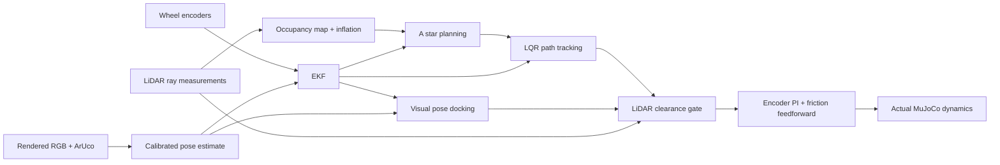

# TurtleBot3: LiDAR Navigation and ArUco Visual Docking

Track A simulation project: an actual MuJoCo TurtleBot3 scans a room, plans around an obstacle,
tracks the route with estimated-state LQR feedback, and visually docks at an ArUco charging station.
The blue docking area turns green after pose and recent visual-measurement conditions are held.
Electrical charging is outside this simulation's scope.

**Group number:** __________  
**Course:** __________

| Member name | Student ID (if required) | Actual contribution |
|---|---|---|
| __________ | __________ | __________ |
| __________ | __________ | __________ |
| __________ | __________ | __________ |

**[中文完整说明、参数、限制和答辩稿](docs/FULL_PROJECT_CN.md)**

## Run

Python 3.12 and MuJoCo 3.17.0 were used for validation. The modified TB3 model and assets are included.

```powershell
python -m pip install -e ".[evaluation,simulation]"
python run_navigation.py --gui --speed 2
```

On the configured Windows computer:

```powershell
.\.venv-lidar\Scripts\python.exe run_navigation.py --gui --speed 2
```

The default condition includes an obstacle. GUI playback speed changes wall-clock pacing only.
This is the complete task entry; `run_integrated.py` remains the earlier proportional-control baseline.

```powershell
python run_navigation.py --condition obstacle --trials 3 --duration 100
python run_navigation.py --condition camera_dropout --trials 3 --duration 100
python run_navigation.py --condition lidar_dropout --trials 3 --duration 100
python run_navigation.py --condition noisy_encoder --trials 3 --duration 100
python run_navigation.py --condition shifted_start --trials 3 --duration 100
python run_navigation.py --condition nominal --trials 3 --duration 100
python run_navigation.py --condition obstacle --seed 2 --record-video
python calibrate_navigation.py
python -m unittest discover -s tests -v
```

`--seed` selects the initial seed; `--run-id` selects a unique log identifier. Duplicate identifiers
are rejected to preserve prior evidence. Outputs default to `results/navigation/`.

## Pipeline



The planner receives only LiDAR and estimated pose. The controller receives estimated pose and
joint encoder feedback. Simulator base pose and contact truth are used for evaluation and trial termination.
Rendering and ray casting use simulation geometry internally as sensor models, not as state feedback.

## A. Modelling and analysis

The nonlinear differential-drive model is `xdot=v*cos(theta), ydot=v*sin(theta), thetadot=omega`.
Nominal radius is 0.033 m and effective track is 0.287 m. XML wheel spacing is approximately 0.288 m;
this small parameter mismatch and slip are treated as model uncertainty.

At nominal moving-reference speed 0.12 m/s and 0.02 s sampling, the reference-frame error model is:

$$A=\begin{bmatrix}1&0&0\\0&1&0.0024\\0&0&1\end{bmatrix},\qquad
B=\begin{bmatrix}0.02&0\\0&0\\0&0.02\end{bmatrix}.$$

The controllability rank is 3 and the pose-camera observability rank is 3. At zero reference speed
this linearisation has controllability rank 2, so the moving LQR result is not a global proof.
Encoders alone cannot observe absolute pose drift. See [numeric analysis](docs/results/model_analysis.json).

## B. Sensing and calibration

The camera is 640x480, fovy=60 deg, with zero distortion by virtual pinhole design.
Intrinsics are obtained from configuration and checked on 12 independent known poses:
position RMSE 0.00576 m, heading RMSE 0.243 deg. These are static virtual-sensor validation results.

ArUco dictionary 4X4_50, ID 0, black marker width 0.18 m. The world marker is at (1.5,0,0.2).
Subpixel corners, iterative PnP and full SE(3) mounting transforms produce measurements.
Reprojection/depth checks and EKF innovation gating reject inconsistent detections.
See [calibration evidence](docs/results/calibration/validation.json).

The 180-beam LiDAR excludes all robot geometries. Range is in metres, angles in radians,
robot +X forward and +Y left. Missing measurements stay missing and trigger conservative stopping.
Known-surface ray tests validate geometry only; floating-point error is not real hardware precision.

## C. Estimation

A midpoint wheel-odometry EKF runs at 50 Hz, with visual corrections at 10 Hz.
Process noise includes wheel uncertainty and model mismatch, avoiding the earlier optimistic
covariance during slip. The model-mismatch rates are 0.02 m/sqrt(s) and 3 deg/sqrt(s).
Visual R is diag(0.025^2,0.025^2,(3deg)^2). The squared Mahalanobis gate is 16.27.
Joseph covariance updates preserve numerical symmetry and positive semidefiniteness.
These parameters are simulation design assumptions, not fitted hardware noise statistics.

## D. Control and docking

The discrete LQR uses Q=diag(6,40,10), R=diag(4,2), with gain approximately
`[[1.20984,0,0],[0,4.36328,2.41496]]` and closed-loop eigenvalues
0.95652, 0.99518, 0.97580. Higher lateral weight prioritises clearance; input weights moderate turns.
Saturation and switching require experimental checks beyond this local result.

The original friction remains. An encoder PI inner loop and friction feedforward compensate the
low-speed dead zone. The path is geometric; tracking metrics use the online projected reference,
not a predetermined timing schedule.

PBVS docking uses a goal base pose (1.05,0,0) relative to the known marker. The controller may back
away to realign because a differential-drive robot cannot translate sideways. Marker loss returns
to acquisition. Scan-based arc/footprint checks also cover reverse manoeuvres.

The estimated pose and recent raw visual pose must satisfy tighter tolerances for 0.6 s before
DOCKED. Independent success requires true position <=0.05 m, heading <=5 deg, no collision and
no timeout. These are the team's explicit criteria, not a universal tolerance prescribed by the brief.

## E. Evaluation

Six conditions, seeds 0..2 each: nominal, obstacle, camera dropout (4-7 s), LiDAR dropout (3-5 s),
5x encoder noise, and a known shifted initial pose. Non-nominal conditions include an obstacle with
small seeded position changes. A shifted prior is known; this does not demonstrate global relocalisation.

| 条件 | 成功 | 碰撞 | 平均位置误差(cm) | 平均朝向误差(deg) | 平均耗时(s) |
|---|---:|---:|---:|---:|---:|
| camera_dropout | 3/3 | 0 | 0.349 | 1.972 | 52.45 |
| lidar_dropout | 3/3 | 0 | 1.043 | 1.589 | 57.90 |
| noisy_encoder | 3/3 | 0 | 0.689 | 1.571 | 54.04 |
| nominal | 3/3 | 0 | 1.380 | 0.440 | 11.59 |
| obstacle | 3/3 | 0 | 0.894 | 1.371 | 52.07 |
| shifted_start | 3/3 | 0 | 1.059 | 0.947 | 65.22 |


The 18 completed trials succeeded with no collisions. One earlier multi-trial execution ended
before shifted-start seed 2 finished; its partial sensor log and [attempt note](docs/results/navigation/attempt_notes.json)
are retained, and the same seed passed on restart. Completed-trial statistics do not claim zero execution interruptions.

Raw states, covariance, commands, seeds, conditions and configuration are preserved under
[docs/results/navigation](docs/results/navigation). [Success plot](docs/results/navigation/report/success_rate.png)
and [error plot](docs/results/navigation/report/final_position_error.png) are generated from those CSVs.

The historical baseline failed 12/12 waypoint trials. Planning, vision, estimation and wheel control
changed together, so this is an overall-system comparison rather than a causal LQR-only ablation.

### Limits

Only a simple static room, one rectangle, a fixed landmark, limited start changes and ideal virtual sensors
were tested. Repeated acquisition/reapproach can make docking slow. No dynamic pedestrian prediction,
SLAM, hardware validation or electrical charging is claimed. Three seeds per condition provide limited
evidence, not a universal guarantee or confidence bound on all deployments.

## Demo and submission

See [demo video](docs/demo/final_demo.mp4), containing actual MuJoCo/camera footage, estimated and
true states, marginal uncertainty, varied sensing conditions and quantitative results.
This is a captioned computational demonstration; the team must review it before submission.

The team must fill the group and member identities, agree actual contributions, publish accessible
repository/video links on Canvas, and attend the individual viva. These external steps are not automated.

## Contributions, AI and sources

- Team starting work: MuJoCo model integration, encoder odometry, camera/ArUco and initial EKF.
- Earlier LiDAR contribution: processing, range correction, logging and baseline evaluation.
- Complete navigation extension: AI-assisted A*, LQR, encoder PI, SE(3) vision, EKF update, docking,
  regression tests, experimental automation, Chinese comments, documentation and demo generation.
- Individual names and review/integration responsibilities: **team to fill based on actual work**.

OpenAI ChatGPT and Codex assisted explanations, generated code, debugging, tests and documentation.
The team is responsible for understanding, reviewing and validating the final submission. Do not
describe generated modules as independently handwritten work or attribute them to a member without agreement.

The original ROBOTIS model licence is retained under models/robotis_tb3/LICENSE. Course tutorials,
the team's rosbridge starting interface and MuJoCo examples are acknowledged.
References: [MuJoCo velocity actuator](https://mujoco.readthedocs.io/en/stable/XMLreference.html#actuator-velocity),
[MuJoCo ray casting](https://mujoco.readthedocs.io/en/stable/APIreference/APIfunctions.html#mj-ray),
[OpenCV ArUco](https://docs.opencv.org/5.0/tutorials/objdetect/aruco_detection/aruco_detection.html).

Earlier project/API documentation is preserved in [BASELINE_README](docs/BASELINE_README.md).
